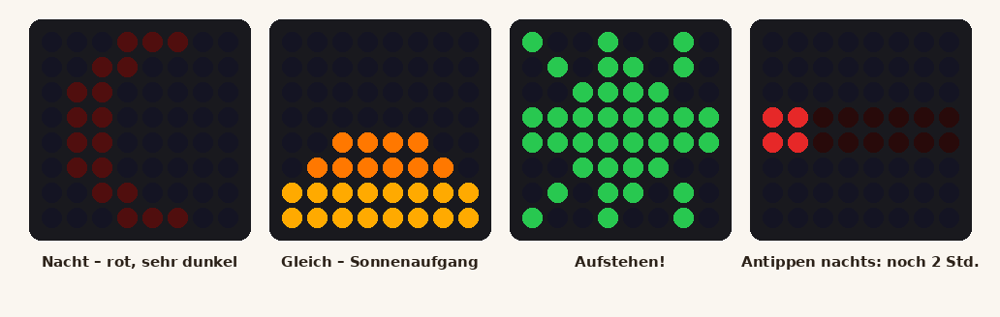

# Plan: Aufsteh-Ampel 🚦

**Stand:** Plan, noch nicht gebaut. Erst nach „Los“ umsetzen.

Ein kleines Licht am Bett des Kindes zeigt, ob es noch schlafen soll oder aufstehen darf – ohne Uhr lesen zu
müssen. Die Zeiten stellen die Eltern in der FamilyConnect-App ein.

## Was das Kind sieht

| Phase | Anzeige | Wann |
| --- | --- | --- |
| 🌙 Nacht | roter Mond, sehr dunkel (oder ganz aus) | ab Schlafenszeit bis kurz vor dem Aufstehen |
| 🌅 Gleich | Sonnenaufgang: die Matrix füllt sich langsam von unten mit Orange/Gelb | z. B. 15 Min. vor der Aufstehzeit |
| ☀️ Aufstehen! | grüne Sonne mit Strahlen, leicht pulsierend | ab Aufstehzeit, z. B. 45 Min. lang, dann aus |
| 💤 Mittagsschlaf | wie Nacht, mit Countdown | per Knopf in der App („60 Min. ab jetzt“) |

**Antippen** (Berührungssensor oben auf dem Gehäuse):
- nachts: kurzer roter Balken „wie lange noch“ (ein Punkt je halbe Stunde), dann wieder Mond
- in der grünen Phase: **„Ich bin wach“** – hakt in der App die Gewohnheit „Aufstehen“ ab (und gibt Punkte, wenn Punkte eingeschaltet sind)

**Helligkeit:** Der Lichtsensor (BH1750) misst das Zimmer – im Dunkeln leuchtet die Ampel ganz schwach, damit
sie niemanden weckt; tagsüber heller.

## In der App (Familie & Profil → Geräte → Aufsteh-Ampel)

- Ampel anlegen → Code für das Gerät (wie beim Wanddisplay und der Musik-Box), einem Kind zuordnen
- **Zeiten** je Kind: Schlafenszeit und Aufstehzeit für **Mo–Fr** und **Sa/So** getrennt
- **Ferien und Feiertage** (Bundesland ist schon eingestellt) gelten automatisch wie Wochenende – abschaltbar
- **Heute ausschlafen** / **morgen früher** als Ausnahme für einen Tag
- **Mittagsschlaf starten** (30/60/90 Min.)
- Sonnenaufgang-Dauer (0/10/15/30 Min.), Nachtlicht an/aus, grüne Phase wie lange
- Status: „Ampel online · gerade 🌙 Nacht · Aufstehen um 6:45“

## Technik

- **Server:** neue Geräte-Schnittstelle `GET /api/wake-light/<code>` liefert den Plan für heute und morgen
  (schon mit Ferien/Feiertagen und Ausnahmen verrechnet) und die Uhrzeit. `POST …/awake` für „Ich bin wach“.
- **Firmware:** holt den Plan alle 60 Sekunden; Uhrzeit per NTP. Fällt das WLAN aus, läuft die Ampel mit dem
  zuletzt geladenen Plan weiter – das Kind wird nie „falsch“ geweckt. Ohne Plan: dauerhaft gedimmter Mond.
- **Helligkeit begrenzt:** höchstens ca. 30 % (die 64 LEDs könnten sonst bis 3,8 A ziehen) – reicht völlig
  und schont das Netzteil.

## Teile

| Teil | Status |
| --- | --- |
| WS2812B-Matrix 8×8 | ✅ vorhanden |
| BH1750 (zweiter) | ✅ vorhanden |
| TTP223 Berührungssensor | ✅ vorhanden |
| ESP32-C3 SuperMini | 🛒 kaufen (oder den ESP32-S3 nehmen, wenn die Familien-Station ihn nicht braucht) |
| USB-Netzteil 5 V / 2 A + USB-C-Kabel | 🛒 kaufen |
| Elko 1000 µF (an 5 V der Matrix) und Widerstand 330 Ω (in der Datenleitung) | 🛒 kaufen (Centartikel) |
| Weißes Filament für die Streuscheibe | evtl. vorhanden |

## Gehäuse (3D-Druck)

Würfel ca. 75 × 75 × 45 mm: vorne eine 0,8 mm dünne weiße Streuscheibe, dahinter ein Raster mit 64 Kammern,
damit jedes „Pixel“ ein klarer Punkt bleibt. Oben die Mulde für den Berührungssensor (wirkt durch 1–2 mm
Kunststoff), hinten USB-C. Optional Ohren/Wolke als Aufsatz, damit es nach Kinderzimmer aussieht.

## Noch zu klären

1. Für welches Kind (oder zwei Ampeln)? Ungefähre Zeiten Mo–Fr und Wochenende?
2. Nachts lieber **roter Mond** oder **ganz aus**?
3. „Ich bin wach“ mit Punkten verbinden?
4. Gehäuse schlicht oder mit Motiv (Wolke, Katze, Bär …)?
5. ESP32-C3 kaufen oder den S3 nehmen?
