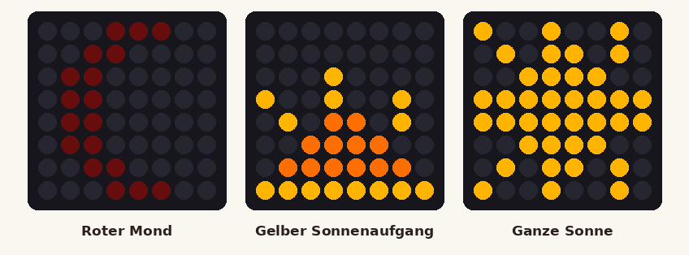
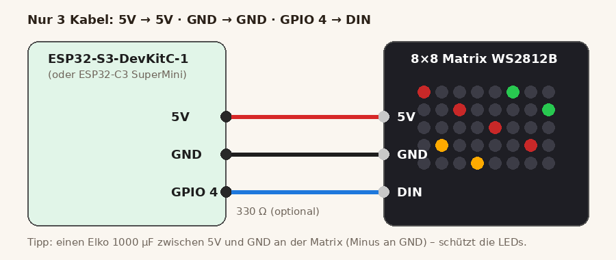
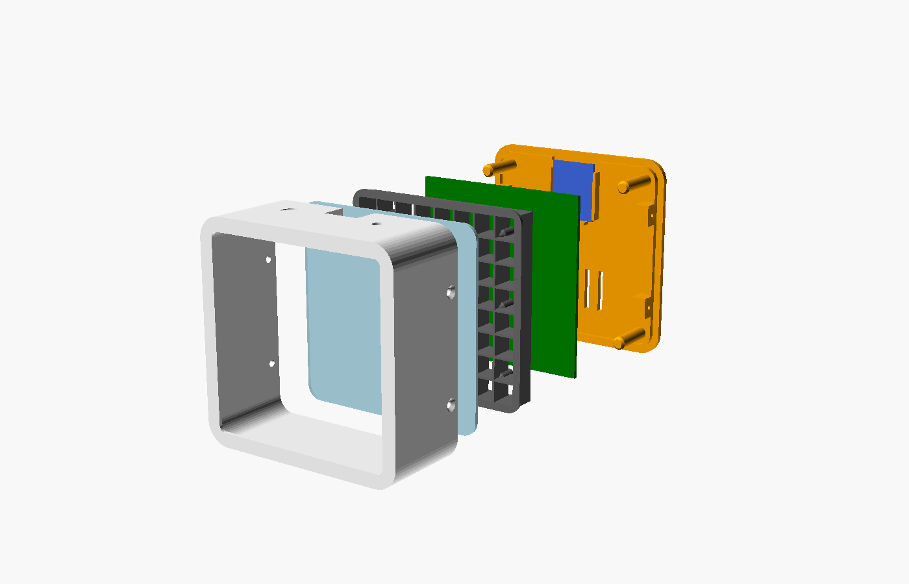

# Aufsteh-Ampel – erster Test (nur ESP32 + 8×8-Matrix)

Ohne App, ohne WLAN: Die Matrix zeigt im Kreis einen **roten Mond**, einen **gelben Sonnenaufgang** (geht langsam
von unten auf) und die **ganze Sonne** (pulsiert sanft). Die **BOOT-Taste** auf dem ESP32 springt sofort zum
nächsten Bild. Der ganze Plan mit App-Anbindung steht in [docs/plaene/aufsteh-ampel.md](../../docs/plaene/aufsteh-ampel.md),
den Stand für einen eigenen Chat fasst [UEBERGABE.md](UEBERGABE.md) zusammen.



## Verkabelung – 3 Kabel



| Matrix | ESP32-S3-DevKitC-1 | ESP32-C3 SuperMini |
| --- | --- | --- |
| **5V** (oft „VCC“ oder „+5V“) | 5V | 5V |
| **GND** | GND | GND |
| **DIN** (Eingang – nicht DOUT!) | GPIO 4 | GPIO 4 |

- Die Matrix hat zwei Anschlussseiten: **DIN** (Eingang) und **DOUT** (Ausgang zum nächsten Panel). Nur DIN benutzen –
  oft zeigt ein kleiner Pfeil auf der Platine *in* die Matrix hinein.
- Optional, aber gut: **330 Ω** in die Datenleitung und **1000 µF Elko** zwischen 5V und GND direkt an der Matrix
  (langes Bein = Plus an 5V).
- Strom über das USB-Kabel des ESP32 reicht – die Helligkeit ist im Programm auf ca. 15 % begrenzt.

## Aufspielen

Wie bei der Musik-Box (VS Code + PlatformIO):

```
cd hardware/aufsteh-ampel/firmware
pio run -e s3 -t upload      # ESP32-S3-DevKitC-1
pio run -e c3 -t upload      # oder ESP32-C3 SuperMini
pio device monitor           # zeigt „🌙 Mond“, „🌅 Sonnenaufgang“, „☀️ Sonne“
```

Kein `config.h` nötig – es gibt kein WLAN-Passwort.

## Anpassen

In `firmware/include/einstellungen.h`:

| Einstellung | Wofür |
| --- | --- |
| `HELLIGKEIT`, `HELLIGKEIT_MOND` | Helligkeit (0–255) |
| `DAUER_MOND`, `DAUER_SONNENAUFGANG`, `DAUER_SONNE` | Sekunden je Bild |
| `SONNE_GRUEN` | 1 = ganze Sonne in Grün (Ampel: „darfst aufstehen“) |
| `ZICKZACK` | **Bild zerstückelt?** → auf 1 stellen (viele biegsame Matrizen laufen im Zickzack) |
| `SPIEGELN`, `KOPFUEBER` | Bild seitenverkehrt oder auf dem Kopf? |

Die Bilder selbst stehen oben in `firmware/src/main.cpp` als 8 Zeilen Text (`R` rot, `O` orange, `Y` gelb, `G` grün,
`.` aus) – einfach Zeichen ändern und neu aufspielen.

## Wenn etwas nicht geht

| Problem | Lösung |
| --- | --- |
| Gar nichts leuchtet | DIN statt DOUT? 5V wirklich an 5V (nicht 3V3)? GND verbunden? |
| Nur die erste LED flackert / Farben wild | GND gemeinsam? 330-Ω-Widerstand einsetzen, Kabel kürzer |
| Bild sieht zerhackt aus | `ZICKZACK 1` |
| Bild seitenverkehrt / oben-unten vertauscht | `SPIEGELN 1` bzw. `KOPFUEBER 1` |
| Upload klappt nicht (C3) | BOOT halten, RESET kurz drücken, BOOT loslassen, nochmal hochladen |

## Gehäuse (3D-Druck)



Würfel 76 × 76 × 32 mm. Vorne leuchtet die Matrix durch eine 0,8 mm dünne Streuscheibe; dahinter trennt ein Raster
mit 64 Kammern die LEDs, damit Mond und Sonne aus klaren Punkten bestehen. Modell zum Anpassen:
[3d/aufsteh-ampel.scad](3d/aufsteh-ampel.scad) (Maße der Matrix: 65,5 × 66,5 mm, Löcher Ø 2,5 im Abstand 49 × 25 mm).

| Datei | Was | Wie drucken |
| --- | --- | --- |
| [raster_test.stl](3d/raster_test.stl) | **Zuerst:** 4 mm flaches Raster zum Probieren | wie das Raster |
| [gehaeuse.stl](3d/gehaeuse.stl) | Gehäuse mit Streuscheibe | **weiß**, Front nach unten, ohne Stützen, 0,2 mm Schicht |
| [raster.stl](3d/raster.stl) | Raster mit 64 Kammern und 6 Schraubdomen | Dome nach oben, ohne Stützen; gern schwarz oder grau |
| [rueckwand.stl](3d/rueckwand.stl) | Rückwand mit Halter für den ESP32-C3 SuperMini | glatte Seite nach unten |

**Test zuerst:** `raster_test.stl` auf die Matrix legen (Dome zur Platine) und einschalten. Sitzt jede LED mittig in
ihrem Kästchen und passen die Dome auf die Löcher? Dann das ganze Raster drucken. Sonst sag Bescheid, dann passe
ich den LED-Abstand im Modell an.

**Tipp für den Druck:** Das Gehäuse komplett in Weiß drucken, dann leuchten Mond und Sonne schön weich. Soll der
Würfel eine andere Farbe haben: im Slicer bei **0,8 mm Höhe** einen Farbwechsel/Pause einfügen und ab dort die
Wunschfarbe drucken (die Streuscheibe bleibt weiß).

**Zusammenbau**

1. Kabel an die Matrix löten (5V, GND, DIN – siehe oben) und nach hinten führen.
2. Raster auf die LED-Seite der Matrix legen (Dome zu den Löchern) und mit **4–6 Schrauben M2 × 6** von hinten durch
   die Platine in die Dome schrauben – nur leicht anziehen.
3. Raster + Matrix ins Gehäuse stecken: das Raster rutscht vorne in die Vertiefung hinter der Streuscheibe.
4. **Später für die App:** Berührungssensor TTP223 innen oben rechts in die dünne Stelle kleben (außen ist dort ein
   kleiner Punkt zum Antippen), Lichtsensor BH1750 innen oben links unter das kleine Loch kleben.
5. ESP32-C3 in den Halter der Rückwand legen, **USB-C zum Rand** (zur Aussparung unten), mit einem Klecks Heißkleber
   sichern. Den Elko neben den ESP legen.
6. Rückwand aufsetzen und mit **4 Schrauben M2 × 8** (Senkkopf) festschrauben. Das USB-Kabel kommt unten heraus.
