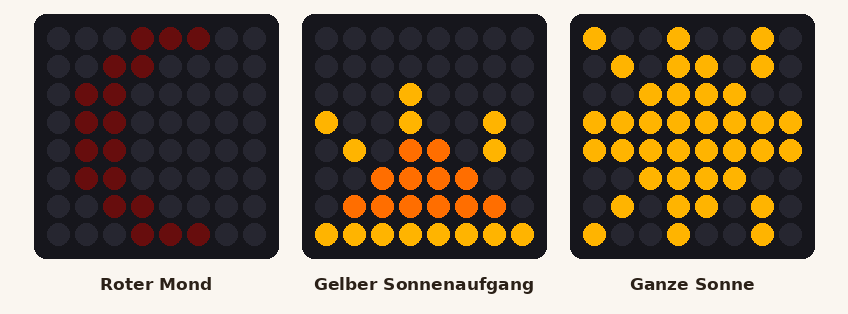
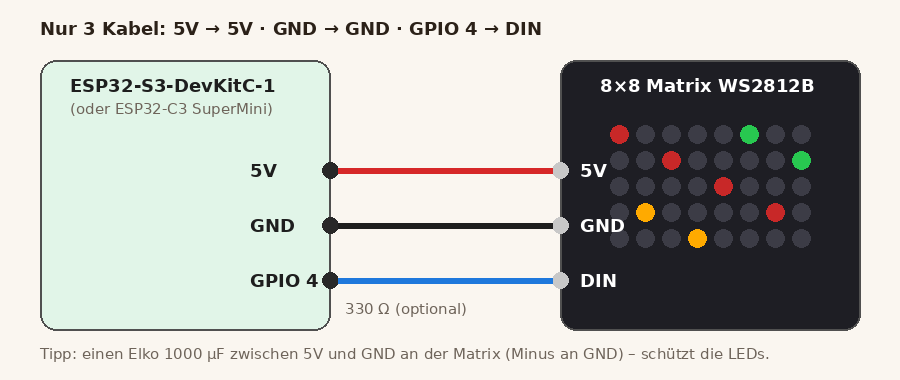

# Aufsteh-Ampel – erster Test (nur ESP32 + 8×8-Matrix)

Ohne App, ohne WLAN: Die Matrix zeigt im Kreis einen **roten Mond**, einen **gelben Sonnenaufgang** (geht langsam
von unten auf) und die **ganze Sonne** (pulsiert sanft). Die **BOOT-Taste** auf dem ESP32 springt sofort zum
nächsten Bild. Der ganze Plan mit App-Anbindung steht in [docs/plaene/aufsteh-ampel.md](../../docs/plaene/aufsteh-ampel.md).



## Verkabelung – 3 Kabel



| Matrix | ESP32-S3-DevKitC-1 | ESP32-C3 SuperMini |
| --- | --- | --- |
| **5V** (oft „VCC“ oder „+5V“) | 5V | 5V |
| **GND** | GND | GND |
| **DIN** (Eingang – nicht DOUT!) | GPIO 4 | GPIO 4 |

- Die Matrix hat zwei Anschlussseiten: **DIN** (Eingang) und **DOUT** (Ausgang zum nächsten Panel). Nur DIN benutzen –
  oft zeigt ein kleiner Pfeil auf der Platine *in* die Matrix hinein.
- Optional, aber gut: **330 Ω** in die Datenleitung und **1000 µF Elko** zwischen 5V und GND direkt an der Matrix
  (langes Bein = Plus an 5V).
- Strom über das USB-Kabel des ESP32 reicht – die Helligkeit ist im Programm auf ca. 15 % begrenzt.

## Aufspielen

Wie bei der Musik-Box (VS Code + PlatformIO):

```
cd hardware/aufsteh-ampel/firmware
pio run -e s3 -t upload      # ESP32-S3-DevKitC-1
pio run -e c3 -t upload      # oder ESP32-C3 SuperMini
pio device monitor           # zeigt „🌙 Mond“, „🌅 Sonnenaufgang“, „☀️ Sonne“
```

Kein `config.h` nötig – es gibt kein WLAN-Passwort.

## Anpassen

In `firmware/include/einstellungen.h`:

| Einstellung | Wofür |
| --- | --- |
| `HELLIGKEIT`, `HELLIGKEIT_MOND` | Helligkeit (0–255) |
| `DAUER_MOND`, `DAUER_SONNENAUFGANG`, `DAUER_SONNE` | Sekunden je Bild |
| `SONNE_GRUEN` | 1 = ganze Sonne in Grün (Ampel: „darfst aufstehen“) |
| `ZICKZACK` | **Bild zerstückelt?** → auf 1 stellen (viele biegsame Matrizen laufen im Zickzack) |
| `SPIEGELN`, `KOPFUEBER` | Bild seitenverkehrt oder auf dem Kopf? |

Die Bilder selbst stehen oben in `firmware/src/main.cpp` als 8 Zeilen Text (`R` rot, `O` orange, `Y` gelb, `G` grün,
`.` aus) – einfach Zeichen ändern und neu aufspielen.

## Wenn etwas nicht geht

| Problem | Lösung |
| --- | --- |
| Gar nichts leuchtet | DIN statt DOUT? 5V wirklich an 5V (nicht 3V3)? GND verbunden? |
| Nur die erste LED flackert / Farben wild | GND gemeinsam? 330-Ω-Widerstand einsetzen, Kabel kürzer |
| Bild sieht zerhackt aus | `ZICKZACK 1` |
| Bild seitenverkehrt / oben-unten vertauscht | `SPIEGELN 1` bzw. `KOPFUEBER 1` |
| Upload klappt nicht (C3) | BOOT halten, RESET kurz drücken, BOOT loslassen, nochmal hochladen |
